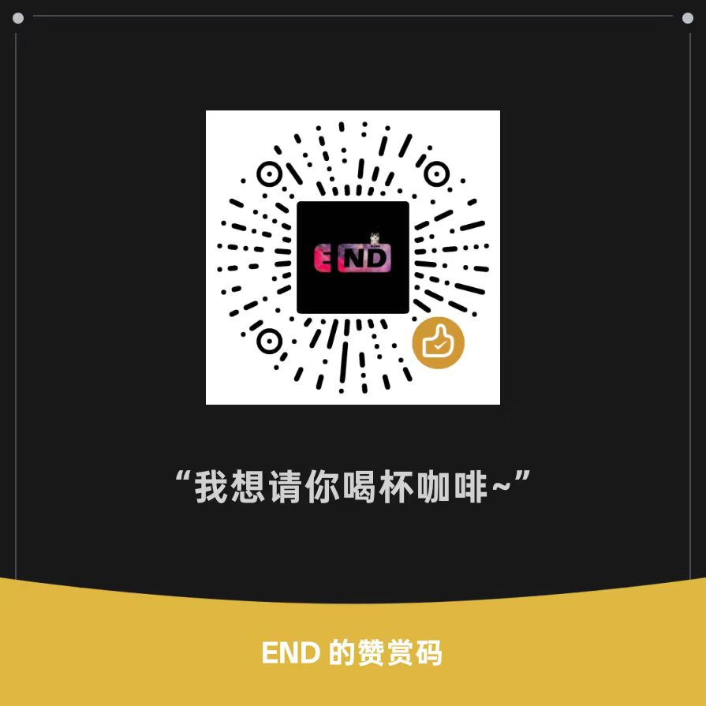

# 观影助手

去除第三方视频软件中的烦人广告。

## 仅在以下版本上进行测试：
- 稀饭动漫 Next v6.1.2
- Mi动漫 v2.4.1
- 橘汁 v3.0.8.0
- MiNO v1.0.13
- 咕噜咕噜 v2.2.5（仅去广告，无面板）
- 电影猎手 v3.1.2.4
- 好好看 / 网飞猫 / 可可影视 v3.5.0 ( V3.5.1 )
- 豆瓣 v7.118.0

## 使用说明
- 作用域默认仅添加了测试时的包名；如果你使用的是同版本的其它包名，可手动添加作用域。
- 在对应 App 的设置页面可以看到模块的设置面板，可进行一些简单调整。

## 反馈
公众号：FindApps

## 赞赏

如果这个模块帮到了你，欢迎请我喝杯咖啡~

捐赠完全自愿，与功能无关。

